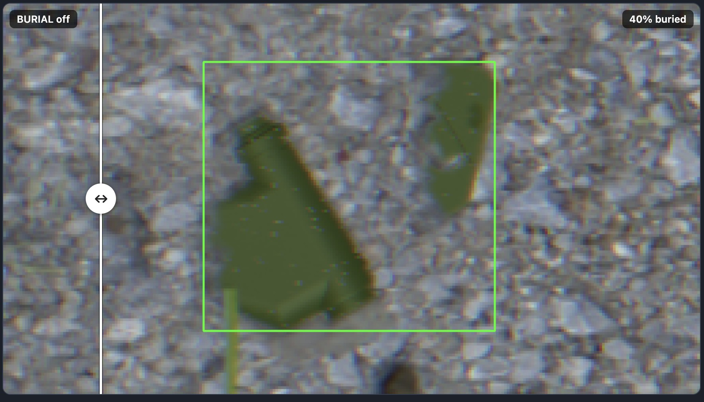
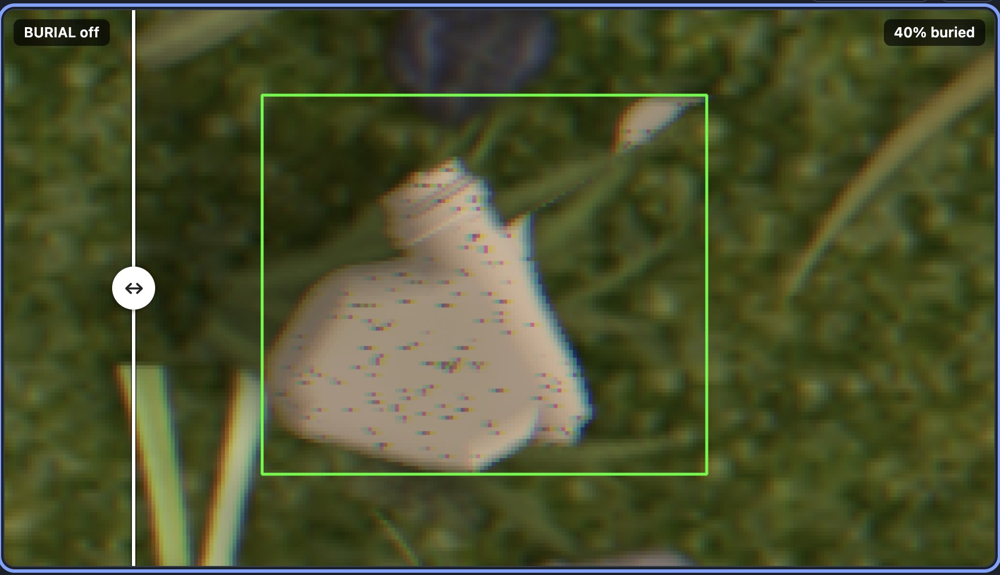
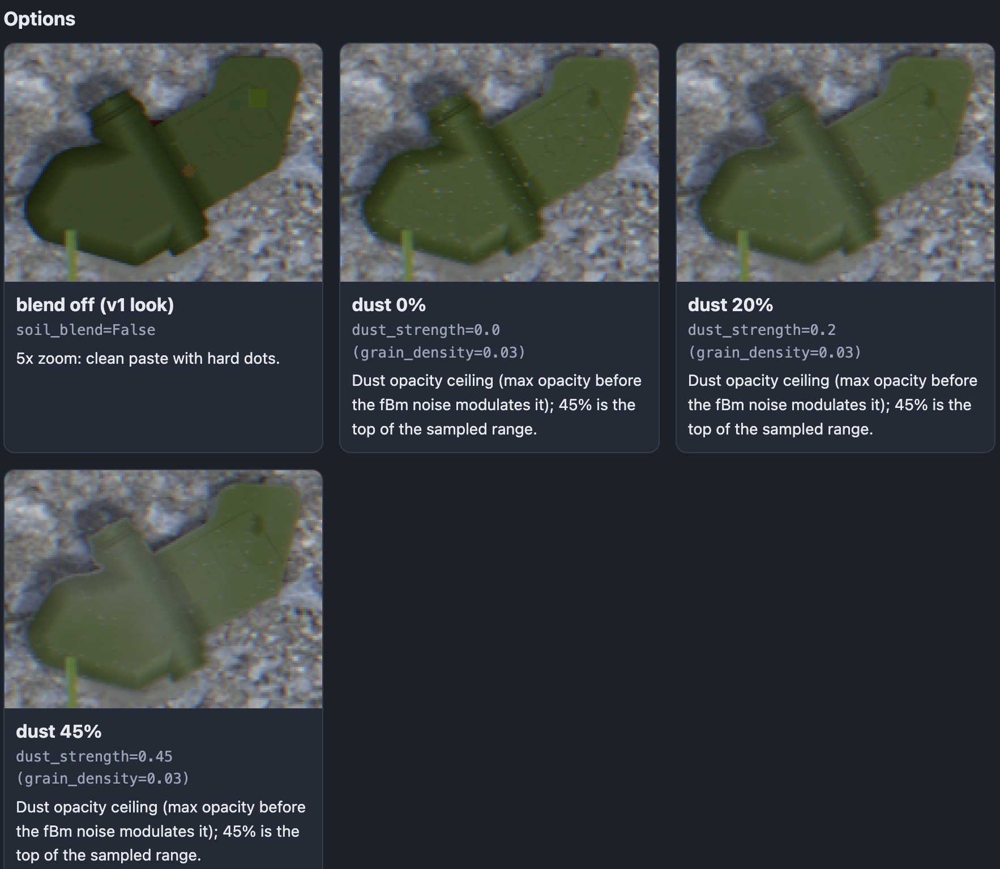
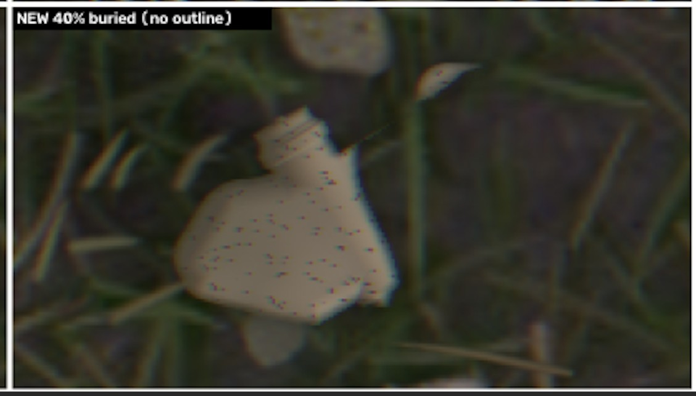

# 0006: burial round 1, leftover outline line and sideways shift (plus dust and blades)

Date: 2026-10-20 (feedback 05:40Z = 01:40 EDT; fix reported 05:54Z)

## Context

From the v2 showcase the user sent three screenshots (see feedback 0016). Verdicts:

1. A 40%-buried mine on a gravel background "looks great": the buried part is in the middle, the rocky background makes it believable, and it blends irregularly (some rock goes further than others past the plane intersection line). This became the reference for "believable" and the reason later rounds treat the old 40% look as a baseline.
2. A tan mine on grass "doesn't look good": a 1-2 pixel line was left where the unburied top outline would have been, and the mine itself was slightly shifted sideways between the burial-off and burial-on renders.
3. Dust: "bump up the dust to average around 35% and be between 25 and 50%".
4. "add more Blades over the mines. in the example shown in the html there are 0 blades over the mine".

Screenshots (copies are in `images/`): the gravel case, the tan-on-grass case, and the dust options strip.

## Decision

- Leftover line: the soil lip had been measured from the whole buried region, so it also drew a band along the original unburied outline. It is now drawn only along the true soil line (where visible mine meets the soil-covered part).
- Shift: burial no longer moves the mine. Placement uses the bounding box of the unclipped silhouette, the canvas origin is snapped to whole pixels relative to the unclipped mesh, and dust and grain noise are computed on the unclipped silhouette's box, so burial on/off differ only in the buried part, the soil overlay and the shadow.
- Cap: if the rough soil line would push the hidden area past 50%, soil is kept off the visible mine (200-image check: maximum achieved 0.50 over 255 buried mines).
- Regression test `tests/test_burial.py` (5 seeds/poses including face down: anchor offset 0 px, every buried-mine pixel inside the unburied silhouette, label box inside the unburied box). Figures `docs/burial_fix.png` and `docs/burial_fix_2.png` (script `scripts/burial_fix_figure.py`, `burial_fix_figure_cols.py`).
- Dust: triangular distribution with low 0.25, mode 0.30, high 0.50, which gives mean 0.35 (`DUST_STRENGTH`); measured mean 0.350 over 692 mines, range 0.26-0.48.
- Blades over mines: over-layer count raised to 15-60 and a targeted setting `BLADES_OVER_ON_MINE` = 0.6 that places 1-4 extra blades/tufts/wisps centred on the mine box (200 images: 59% of mines get targeted blades, 65% have more than 1% of their area covered, mean visible fraction 0.79, all 692 mines still boxed, 12 under 30% visible). Labels follow the occlusion.
- The user also asked for a `burial_fix.png` variant "with a column showing the new burial output image without an outline", which produced `burial_fix_2.png` (old burial off / old 40% / new off / new 40% no outline / new 40% with outline of the unburied mine / difference map). Their next screenshot of that column (below) still showed a faint line at the top, which opened round 2 (ADR 0007).

## Consequences

- Burial on/off pairs now differ only where intended, which also makes the review grid's flip button meaningful (ADR 0010).
- The dust change made mines noticeably more tinted by the ground; the assistant flagged that bleached dark-green mines can look minty.
- The assistant re-opened `burial_fix.png` redundantly while a subagent had already opened it, and the user called it out. Resulting rule: open a visual once per change, skip files a subagent already opened (ADR 0011).

## Feedback that triggered this

- [0016 burial feedback round 1](feedback/0016-burial-feedback-round1.md)
- [0017 burial_fix column request](feedback/0017-burial-fix-column-request.md)
- [0018 re-open rule updates](feedback/0018-reopen-rule-updates.md)
- [0019 burial feedback round 2](feedback/0019-burial-feedback-round2.md) (the screenshot above belongs to this message)

## Commits

- The fix itself is inside the snapshot `e215f70` (2026-10-20 00:52:00 -0400, backfilled estimate), see ADR 0005; the real fix time was about 01:54 EDT.
- `654fcf2` 2026-10-20 01:52:00 -0400 test: add burial and asset audit regression tests (backfilled estimate; includes `tests/test_burial.py` and the figure scripts)
