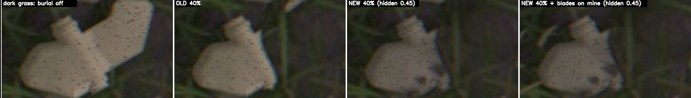

# Feedback 0022: burial line too straight

User text copied verbatim from the session transcript (`7243d6d8-0cfc-40e3-a3d5-7165f3b40d9e.jsonl`). Timestamps are the log's UTC values plus the local equivalent (EDT, UTC-4). Nothing inside the fenced blocks is paraphrased or shortened.

## 2026-10-20T06:27:00.967Z (log line 3309)

- Time: 2026-10-20T06:27:00.967Z UTC = 2026-10-20 02:27:00 EDT
- Kind: user message

```
i think it would help if the burial line wasn't so straight.

for example in this one [Image #6] the line is too straight which causes the additional dirt patches added on top of the mine to not blend well into the existing dirt on the ground covering the right side of the mine
```

Attached screenshots (decoded from the base64 image blocks in the log; the numbering follows the `[Image #N]` markers in the order they appear in the message):



Original screenshot file recorded by the client (metadata line, not typed by the user): `[Image: source: /var/folders/gt/n1_97qrd0ms694clx57pfdt40000gn/T/TemporaryItems/NSIRD_screencaptureui_RsUhOW/Screenshot 2026-10-20 at 2.26.17 AM.png]`

