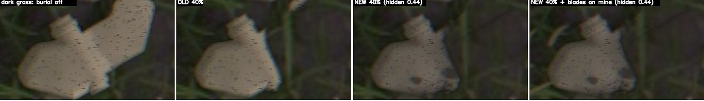

# Feedback 0023: burial still wrong grid 48

User text copied verbatim from the session transcript (`7243d6d8-0cfc-40e3-a3d5-7165f3b40d9e.jsonl`). Timestamps are the log's UTC values plus the local equivalent (EDT, UTC-4). Nothing inside the fenced blocks is paraphrased or shortened.

## 2026-10-20T06:39:29.230Z (log line 3375)

- Time: 2026-10-20T06:39:29.230Z UTC = 2026-10-20 02:39:29 EDT
- Kind: user message

```
[Image #7] this one still looks wrong

also the grid doesn't need to be so large, render 48 instead of 360
```

Attached screenshots (decoded from the base64 image blocks in the log; the numbering follows the `[Image #N]` markers in the order they appear in the message):



Original screenshot file recorded by the client (metadata line, not typed by the user): `[Image: source: /var/folders/gt/n1_97qrd0ms694clx57pfdt40000gn/T/TemporaryItems/NSIRD_screencaptureui_Hq0Uqf/Screenshot 2026-10-20 at 2.38.33 AM.png]`

