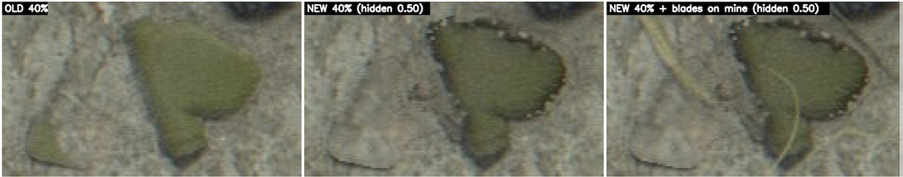

# Feedback 0024: burial unnatural wavy edge

User text copied verbatim from the session transcript (`7243d6d8-0cfc-40e3-a3d5-7165f3b40d9e.jsonl`). Timestamps are the log's UTC values plus the local equivalent (EDT, UTC-4). Nothing inside the fenced blocks is paraphrased or shortened.

## 2026-10-20T06:51:54.613Z (log line 3441)

- Time: 2026-10-20T06:51:54.613Z UTC = 2026-10-20 02:51:54 EDT
- Kind: user message

```
now it looks unnatural. also, in this example the old one actually looks better since it's more believable [Image #8]


the burial edge should be wavey to look more natural instead of it being a straight line. you should sample some combination of sin and cos waves at different amplitudes/freq + some noise on top. spawn clods/crumbs but limit their number and vary their size more. also, don't spawn them around the entire mine since it looks "forced" in that it's too uniform

don't restart the grid yet, I will send more examples from that so you are able to make more informed changes in the next update
```

Attached screenshots (decoded from the base64 image blocks in the log; the numbering follows the `[Image #N]` markers in the order they appear in the message):



Original screenshot file recorded by the client (metadata line, not typed by the user): `[Image: source: /var/folders/gt/n1_97qrd0ms694clx57pfdt40000gn/T/TemporaryItems/NSIRD_screencaptureui_5SzYmV/Screenshot 2026-10-20 at 2.49.00 AM.png]`

