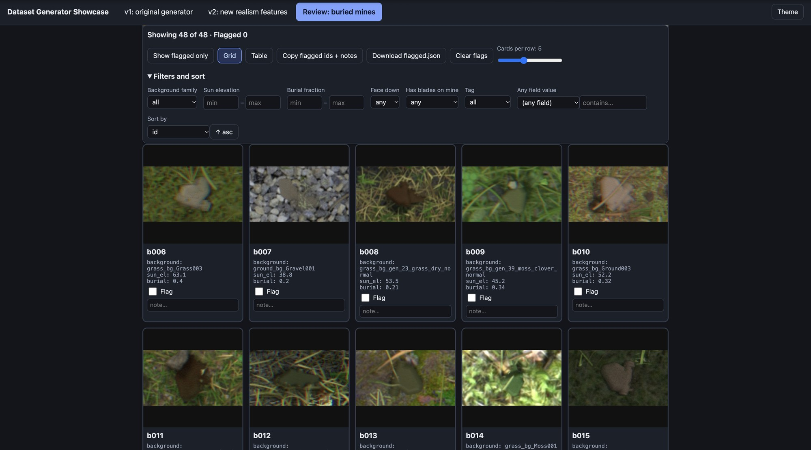

# Feedback 0026: grid layout feedback

User text copied verbatim from the session transcript (`7243d6d8-0cfc-40e3-a3d5-7165f3b40d9e.jsonl`). Timestamps are the log's UTC values plus the local equivalent (EDT, UTC-4). Nothing inside the fenced blocks is paraphrased or shortened.

## 2026-10-20T06:59:46.238Z (log line 3606)

- Time: 2026-10-20T06:59:46.238Z UTC = 2026-10-20 02:59:46 EDT
- Kind: user message

```
[Image #10]

1) make images take up the entire width of the page
2) remove or make the metadata/params smaller under each image and make the text box and flag button larger
3) render the images at higher res (nothing above what would exist in the actual dataset though)
```

Attached screenshots (decoded from the base64 image blocks in the log; the numbering follows the `[Image #N]` markers in the order they appear in the message):



Original screenshot file recorded by the client (metadata line, not typed by the user): `[Image: source: /var/folders/gt/n1_97qrd0ms694clx57pfdt40000gn/T/TemporaryItems/NSIRD_screencaptureui_fKOQAX/Screenshot 2026-10-20 at 2.58.53 AM.png]`

