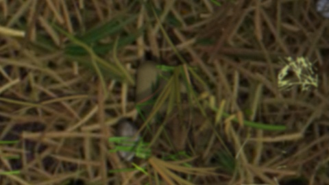
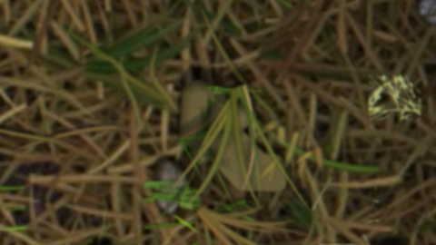
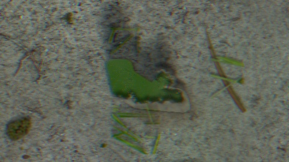
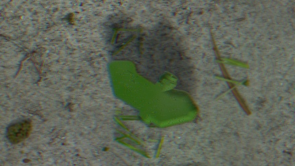
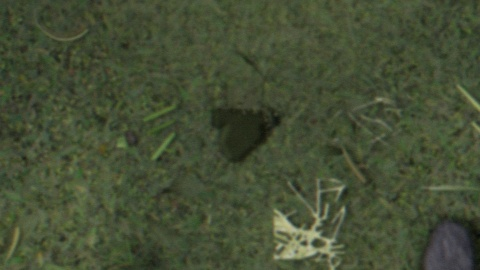
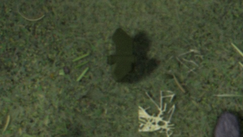
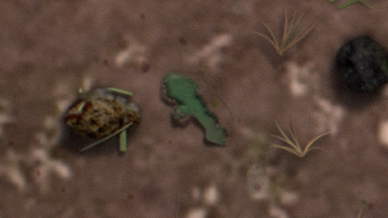
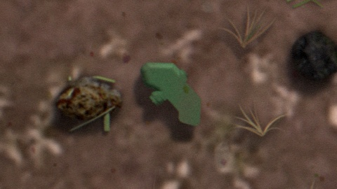
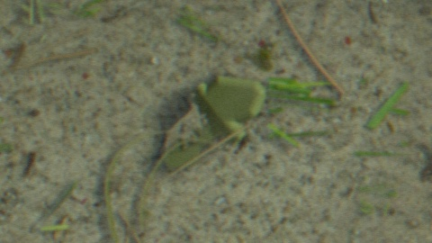
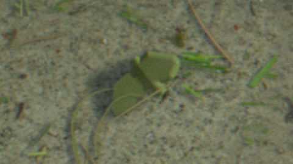

# Review grid (48 cards, ragged-edge generator, commit 61b6a85): user notes, verbatim

Exported from the showcase page; raw export is `0100-review-grid-48-flagged.json`. Notes are the user's exact text. Images are the native-resolution crops (after = buried, before = same scene unburied).

## b001 (seed 5001, grass_bg_gen_23_grass_dry_normal, sun 50.2, burial 0.41, face_down False, blades 4, dust 0.38)

 

```
burial is relatively convincing (only non-believable part is mainly just an unsolvable problem with the background image and how a mine would "weigh into the grass" more in this specific scenario. fixing this issue would require understanding specifics about the materials in each location of each image which is not worth doing). the issue here is that because of the blades on top of the mine it becomes like 80% buried which may be too difficult for anything to learn. we can leave this as is for now and see if models somehow manage anyways. if they don't we can figure out a solution
```

## b002 (seed 5002, ground_bg_Ground005, sun 24.8, burial 0.41, face_down True, blades 0, dust 0.33)

 

```
1) is it intentional for the shape of the shadow of the mine to change? it looks wrong in the burial version (it seems to extend further than it should, and it extends further than in the non-buried image)
2) the sand that is added on top of the mine doesn't blend into the sand on the ground and instead has a sharp shadow line separating them
3) the shadow of the sand on top of the mine is too aggressive/sharp/strong
```

## b004 (seed 5004, grass_bg_real_00_Grass001_grass_fresh, sun 27.4, burial 0.45, face_down False, blades 0, dust 0.28)

 

```
you can still see the outline/shadow around the mine
```

## b019 (seed 5019, ground_Screenshot 2026-02-07 at 4.21.38 PM, sun 32.7, burial 0.4, face_down True, blades 0, dust 0.37)

 

```
dirt on top of mine doesn't blend into dirt in the background
```

## b020 (seed 5020, ground_bg_Ground005, sun 16.8, burial 0.19, face_down False, blades 2, dust 0.29)

 

```
sand on top of mine doesn't blend into sand in the background
```
