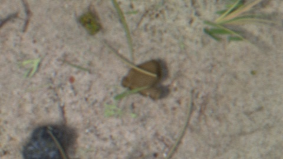
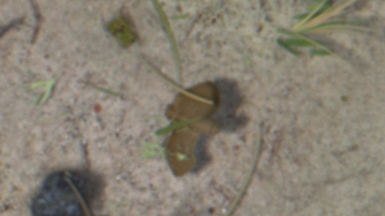
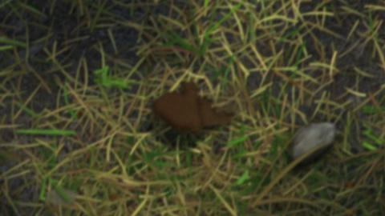
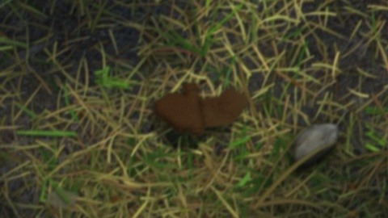
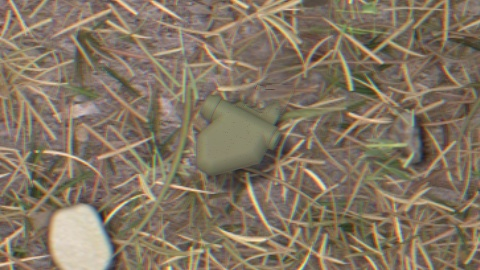
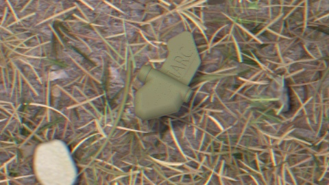

# Review grid (48 cards): all noted cards incl. 3 previously unflagged, verbatim

Raw export: `0102-review-grid-48-flagged-all.json`. New relative to 0100: b005, b008, b022. Notes are exact user text.

## b005 (seed 5005, ground_bg_Ground005, sun 35.1, burial 0.42, face_down False, blades 2, dust 0.32)

 

```
very convincing but a straight line, although the line is along the ridge in the middle of the mine which is believable since it's a real height different in the STL file so it's fine
```

## b008 (seed 5008, grass_bg_gen_23_grass_dry_normal, sun 53.5, burial 0.21, face_down False, blades 0, dust 0.37)

 

```
this isn't related to the burial, but here the mine looks like it's floating on top of the grass (it's not blended into the background). I think the issue is that the shadow is the same size as the mine, so when the sun is at an angle the shadow is offset from the mine and not enough of it is under the mine itself, which makes it look like its floating on the side closer to the sun
```

## b022 (seed 5022, grass_bg_gen_19_grass_dry_normal, sun 60.1, burial 0.32, face_down False, blades 0, dust 0.28)

 

```
mine looks like it's floating
```
